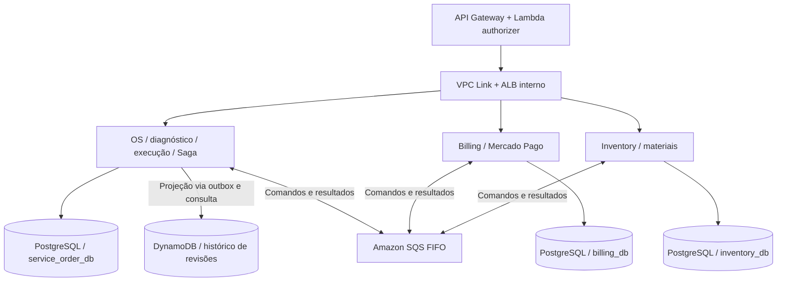

# Proposta para a equipe - Fase 4 na AWS

**Projeto:** NumberOne. **Equipe:** Matheus, Julio, Anderson e Marcelo. **Prazo de planejamento:** três semanas. **Atualização:** 31/10/2026.

## Dicionário para começar a leitura

| Termo da Saga | Aplicação neste projeto |
| --- | --- |
| **Saga / orquestrador** | Código na OS que salva o andamento e decide os próximos comandos para Billing e Inventory |
| **Estado da Saga** | Etapa técnica, como aguardando reserva ou compensando; diferente do status comercial da OS |
| **Comando** | Pedido dirigido a um serviço: `ReserveMaterials` solicita uma reserva ao Inventory |
| **Evento** | Fato ocorrido: `MaterialsReserved` informa que a reserva foi confirmada |
| **Compensação** | Nova operação para neutralizar efeito anterior: liberar reserva ou estornar pagamento |
| **Outbox** | Mensagem pendente salva junto do efeito de negócio; um worker a entrega ao destino |
| **Inbox / idempotência** | Registro e regras que evitam repetir efeitos de mensagens reprocessadas |
| **Correlação / causalidade** | `sagaId` identifica o processo; `causationId` aponta a mensagem que provocou a ação |
| **Timeout / reconciliação** | Prazo vencido deixa o resultado incerto; conferir o resultado antes de decidir |
| **Retentativa / DLQ** | Recuperar falhas transitórias; guardar mensagens esgotadas para análise e reprocessamento |

## 1. Objetivo e escopo das três semanas

Entregar três microsserviços, atendimento completo, Mercado Pago, Saga com compensação e deploy independente em Kubernetes. A divisão acordada é **OS, Billing e Inventory**. Diagnóstico e execução ficam na OS. Inventory cuida das regras de materiais. SQS conecta os serviços; três bancos PostgreSQL preservam a base relacional e um DynamoDB guarda o histórico de revisões dos veículos.

O escopo inicial terá uma revisão de orçamento aprovada e uma tentativa financeira ativa por atendimento, reserva simples e prazo de pagamento controlado pela Saga. Novas versões após aprovação e reinício de processos encerrados ficam para evolução. Manter identificação de filial, sem construir gestão completa de filiais. Aqui, revisão do orçamento e revisão/manutenção do veículo são conceitos diferentes.

Reaproveitar regras, testes e organização atuais. Java 25/Spring Boot 4 e Maven são a base disponível, não uma obrigação adicional para os serviços extraídos. Cada responsável pode escolher tecnologias e padrões internos, documentando a justificativa no README. Contratos, semântica dos estados, segurança, idempotência, testes, cobertura e deploy são acordos comuns. Mudanças que afetem outro serviço exigem alinhamento prévio.

Os recursos AWS abaixo são uma proposta, não evidência de provisionamento. Recuperar a base da fase 3 que o grupo confirmar. O enunciado apresenta Execução/Produção como exemplo de divisão; OS/Billing/Inventory deve ser justificado pelas responsabilidades e independência dos três serviços.

## 2. Serviços, bancos, repositórios e AWS

### 2.1 Responsabilidades e quatro bancos lógicos

| Serviço / responsável | Banco exclusivo | Responsabilidades |
| --- | --- | --- |
| **OS Service / Matheus** | RDS PostgreSQL `service_order_db` | Clientes, veículos, catálogo de serviços/mão de obra, abertura, diagnóstico, itens de serviço e materiais previstos, execução, status, conclusão, entrega, Saga e inbox/outbox |
| **Billing Service / Julio** | RDS PostgreSQL `billing_db` | Orçamento, cálculo/valores aprovados, notificações, cobrança, pagamento, operações Mercado Pago e inbox/outbox |
| **Inventory Service / Anderson** | RDS PostgreSQL `inventory_db` | Peças/insumos, fornecedores, saldo, disponibilidade, reserva, consumo, movimentações e inbox/outbox |
| **Histórico de revisões / sob responsabilidade da OS** | DynamoDB `vehicle_maintenance_history` | Documento consultável por veículo com revisões concluídas, serviços executados, materiais usados, quilometragem e referências da OS |

São **pelo menos quatro bancos lógicos, três aplicações e seis repositórios**. O DynamoDB é um segundo armazenamento da OS, não exige um quarto microsserviço. A OS é dona da tabela e da API de consulta; Billing e Inventory não a acessam. O histórico operacional/Saga permanece no PostgreSQL; o DynamoDB atende à consulta de manutenção do veículo.

Reaproveitar o RDS existente para os dados relacionais que já existem, separando bancos, usuários, permissões e migrations por serviço. Quatro bancos lógicos não significam quatro instâncias RDS. O uso de uma mesma instância física deve ser justificado e manter isolamento; os módulos IaC devem permitir provisionamento independente conforme os recursos/requisitos da entrega. Não compartilhar tabelas nem credenciais de negócio entre serviços.

### 2.2 Os seis repositórios

| Repositório proposto | Conteúdo / responsabilidade |
| --- | --- |
| `numberone-service-order` | Aplicação OS; Matheus. Código, migrations próprias, Dockerfile, manifestos, pipeline e documentação |
| `numberone-billing` | Aplicação Billing; Julio. Mesmos artefatos, com integração Mercado Pago |
| `numberone-inventory` | Aplicação Inventory; Anderson. Mesmos artefatos, com regras de estoque |
| `numberone-database-infra` | Marcelo coordena. IaC dos recursos RDS/bancos/usuários e DynamoDB/índices/backups; donos definem necessidades de dados |
| `numberone-aws-infra` | Marcelo. VPC, EKS, ECR, API Gateway, integração de rede, SQS/DLQs, IAM, Secrets Manager e observabilidade |
| `numberone-auth-lambdas` | Marcelo. Código, testes, pacote, pipeline e recursos das Lambdas de autenticação/autorização |

Centralizar IaC não torna os bancos compartilhados entre aplicações. Cada aplicação continua com configuração, recursos e deploy próprios. Migrations de tabelas SQL ficam nos repositórios das aplicações; infraestrutura física/usuários fica em database-infra. Um recurso tem um único estado IaC responsável. AWS-infra exporta rede/filas; database-infra exporta endpoints/tabelas; auth-lambdas exporta ARN/invoke permission para integração no API Gateway. Documentar a ordem de provisionamento sem referências circulares.

### 2.3 Componentes AWS

| Componente | Uso proposto |
| --- | --- |
| **EKS + ECR** | Três aplicações em Kubernetes, imagens e pipelines independentes; reaproveitar fase 3 |
| **RDS PostgreSQL** | Persistência transacional exclusiva de OS, Billing e Inventory |
| **DynamoDB** | Histórico de revisões do veículo, atualizado pela OS e consultável por sua API |
| **SQS FIFO + DLQs** | Três filas da Saga, uma DLQ FIFO por fila |
| **API Gateway + VPC Link + ALB interno** | Entrada HTTP para serviços no EKS; rotas e integração privada versionadas por IaC |
| **Lambda authorizer / autenticação** | Validar acesso nas rotas administrativas; reaproveitar mecanismo de identidade da fase 3 |
| **IAM / EKS Pod Identity** | Role por ServiceAccount para filas/tabela/secrets necessários, sem chaves AWS fixas |
| **Secrets Manager + ACM** | Credenciais e segredos; HTTPS na entrada e certificado customizado quando aplicável |
| **CloudWatch + observabilidade da fase 3** | Logs, alarmes, dashboards e rastreamento distribuído |

O authorizer valida identidade/token; os serviços validam permissões de negócio e acesso à filial/OS. Webhook Mercado Pago tem rota própria, sem exigir JWT de funcionário, mas Billing valida sua autenticidade e confere o pagamento no provedor. Não aceitar cabeçalhos de identidade sem validação. Definir emissão/validação de tokens nos primeiros dias, reaproveitando o que existir.

GitHub Actions com OIDC publica imagens no ECR e faz deploy no EKS. SonarQube ou equivalente fica no CI. O e-mail usa o provedor funcional existente; SES é opcional. Manter orquestrador e publicadores na aplicação. Step Functions, SNS, EventBridge e DynamoDB Streams não entram no caminho crítico; as Lambdas previstas são as de autenticação.



### 2.4 Como o histórico chega ao DynamoDB

Ao finalizar uma revisão, a OS salva a conclusão e um snapshot para histórico na **mesma transação PostgreSQL**. Um worker lê essa outbox, grava o documento no DynamoDB com chave idempotente e só então marca a entrega no PostgreSQL. Se cair entre as duas operações, repete a gravação com a mesma chave, sem duplicar a revisão. Não existe transação única entre RDS e DynamoDB.

O histórico pode aparecer com pequeno atraso. Falha nessa projeção não desfaz o reparo, nem bloqueia pagamento/entrega; fica pendente para retentativa e alerta. A API da OS consulta o DynamoDB para exibir as revisões por veículo. Esse uso funcional deve aparecer na demonstração, com teste de falha/reprocessamento. Detalhes de chaves e persistência estão no anexo.

## 3. Como era e como ficará

Exemplo: troca de pastilhas, **R$ 150 de mão de obra + um kit de R$ 200 = R$ 350**. Estoque inicial de cinco kits. `OS-123` é fictício; usar UUID nos contratos.

| Operação | Hoje: aplicação/PostgreSQL únicos | Nova divisão |
| --- | --- | --- |
| Abrir, diagnosticar e acompanhar | Dentro de `serviceorder`, `customer` e `vehicle` | Continuam juntos na OS, agora com banco exclusivo |
| Gerar/aprovar orçamento | Billing atualiza diretamente a ordem | Billing calcula/salva no próprio banco e envia eventos |
| Reservar e consumir material | Baixa local ao iniciar item; sem reserva antecipada | Inventory reserva após aprovação e consome por comando da OS |
| Iniciar/concluir serviço | OS acessa estoque pelo gateway local | OS controla execução e aguarda confirmação remota do consumo |
| Pagamento | Integração não identificada | Billing integra Mercado Pago e publica resultados |
| Concluir/entregar e consultar revisões | Operações/dados no banco atual | OS conclui/entrega localmente e projeta histórico no DynamoDB |

Hoje, iniciar a ordem não baixa estoque; `startServiceOrderItem` verifica/consome ao iniciar o item. Reserva, pagamento e Saga são acréscimos. Ver [exemplo com endpoints atuais](fluxo-exemplo-ordem-servico.md).

### 3.1 HTTP, mensagens e chamadas locais

Abrir OS, registrar diagnóstico, iniciar/concluir item e entregar são chamadas HTTP à **OS**. Criar orçamento automaticamente usa `CreateBudget` pelo SQS para Billing. Aprovar orçamento é HTTP no Billing. Reservar/consumir/liberar materiais usa SQS para Inventory. Consultas de catálogo/disponibilidade podem usar REST, sem garantir reserva; só a transação de reserva confirma o saldo.

**`StartDiagnosis`, `DiagnosisCompleted` e `AuthorizeExecution` deixam de ser mensagens entre serviços.** Diagnóstico e autorização agora são operações locais da OS. Ao concluir diagnóstico, a mesma transação registra a composição e `CreateBudget` na outbox. Nenhuma notificação remota é necessária para a OS saber que seu próprio diagnóstico terminou.

```text
HTTP -> ServiceOrderController.completeDiagnosis(id)
     -> DiagnosisService.complete(id)       // chamada Java local
     -> SagaService.requestBudget(...)     // chamada Java local
     -> PostgreSQL OS: diagnóstico + Saga + outbox CreateBudget
     -> worker SQS -> Billing
```

Já o início do item cruza serviços:

```text
HTTP -> OS: marcar START_REQUESTED + outbox ConsumeMaterials
     <- 202 Accepted: início solicitado
SQS  -> Inventory: consumir reserva + movimento + outbox
SQS  -> OS: MaterialsConsumed -> confirmar item IN_PROGRESS
```

A interface acompanha o resultado pela API da OS. O mecânico inicia fisicamente apenas depois da confirmação. Não manter request HTTP ou transação aberta esperando SQS.

### 3.2 Sequência principal

1. OS abre atendimento/Saga e registra o diagnóstico localmente, incluindo serviços e materiais previstos. Catálogo de mão de obra pertence à OS; peças e preços de referência de materiais vêm do Inventory por contrato/API.
2. Concluir diagnóstico congela uma composição proposta e grava `CreateBudget`. Billing calcula o total, salva orçamento e envia para aprovação; publica `BudgetSent`.
3. Aprovação HTTP no Billing gera `BudgetApproved`, com revisão, itens e valores aprovados. OS preserva esse snapshot e pede `ReserveMaterials`.
4. Inventory reserva todos os materiais e responde `MaterialsReserved`; não cria trabalho de execução. OS então pede `RequestPayment` ao Billing.
5. Billing cria checkout e confirma o resultado no Mercado Pago. `PaymentConfirmed` deixa a OS pronta para execução, sem consumir materiais ainda.
6. A equipe solicita início do item pela API da OS. OS salva `START_REQUESTED` e `ConsumeMaterials`; Inventory consome somente a quantidade reservada daquele item e responde `MaterialsConsumed`.
7. OS recebe a confirmação, inicia o item e, no primeiro início, coloca a ordem em execução e conclui a Saga de liberação. Outros itens usam o mesmo protocolo idempotente de consumo, sem repetir pagamento.
8. Equipe conclui itens/reparo na OS. OS finaliza a ordem, grava snapshot para histórico NoSQL e depois registra a entrega. Não recebe evento de conclusão de outro serviço.

```mermaid
sequenceDiagram
    participant O as OS e orquestrador
    participant B as Billing
    participant I as Inventory
    Note over O: Abertura e diagnóstico são operações locais
    O->>B: CreateBudget
    B->>O: BudgetSent / BudgetApproved
    O->>I: ReserveMaterials
    I->>O: MaterialsReserved
    O->>B: RequestPayment
    B->>O: PaymentConfirmed
    Note over O: OS pronta; equipe solicita início pela API
    O->>I: ConsumeMaterials
    I->>O: MaterialsConsumed
    Note over O: Confirmar início; concluir Saga de liberação
    Note over O: Concluir reparo/entregar localmente; projetar histórico
```

As setas entre serviços são SQS; eventos separados por `/` são publicações distintas. A Saga aguarda ações humanas com estado persistido, sem transação aberta. Prazo de pagamento vale até a resolução financeira; depois de pago, não cancelar automaticamente por esse mesmo prazo enquanto aguarda início.

## 4. Reserva, consumo e compensação

### 4.1 Reserva sob responsabilidade do Inventory

OS envia Saga, OS, filial, tentativa, revisão aprovada e materiais/quantidades alocados por item de serviço. Inventory valida quantidades positivas, agrega saldos repetidos e reserva **todos ou nenhum**, em uma transação PostgreSQL. Bloqueia saldos em ordem determinística, valida disponibilidade, grava reserva, inbox e outbox. Chave única de operação e versão impedem duplicação.

| Operação | Físico `onHand` | Reservado `reserved` | Disponível `onHand - reserved` |
| --- | --- | --- | --- |
| Inicial | 5 | 0 | 5 |
| Reservar um kit | 5 | 1 | 4 |
| Consumir ao iniciar item | 4 | 0 | 4 |
| Ou liberar antes do consumo | 5 | 0 | 5 |

Estados por alocação: `RESERVED`, `CONSUMED`, `RELEASED`. Inventory protege consumo/liberação concorrentes com lock/versão da reserva; OS protege início/cancelamento com lock/versão da ordem. A OS manda o comando, mas o Inventory é quem confirma se ele foi aplicado. Nunca há um `@Transactional` cobrindo os dois bancos.

Consumo usa chave estável por reserva/item/operação, cria movimentação uma única vez e devolve o mesmo resultado em repetição. Material já consumido não pode ser liberado como se continuasse reservado. Ajuste manual não pode retirar quantidade comprometida. A Saga controla prazos; visibility timeout SQS não é prazo de reserva. TTL do histórico DynamoDB não libera estoque.

### 4.2 Falhas e compensação

| Situação | Tratamento |
| --- | --- |
| Orçamento rejeitado / estoque insuficiente | OS encerra o fluxo e pede limpeza financeira; sem cobrança. Liberação aceita reserva inexistente de forma idempotente |
| Pagamento recusado e tentativa encerrada | OS entra em compensação, envia `ReleaseMaterials`, espera `MaterialsReleased` e pede `CancelBilling` |
| Pagamento aprovado, cancelamento antes do consumo | OS bloqueia novos inícios, confirma liberação e pede cancelamento/estorno ao Billing |
| Timeout financeiro ou de consumo | Resultado é incerto: reconciliar por tentativa/operação. Não assumir recusa, nem liberar/reembolsar às cegas |
| Material já consumido / reparo iniciado | Inventory responde `MaterialsAlreadyConsumed`; OS registra pendência operacional, sem reposição ou estorno automático |
| Falha na projeção NoSQL | Repetir pela outbox e alertar; não compensar o atendimento concluído |

Compensação automática termina só após `MaterialsReleased` e `BillingCompensated`, com cancelamento local da OS. Billing confirma depois de resolver operações externas; estorno solicitado não significa concluído. Rejeição comercial, falha técnica e resultado desconhecido têm tratamentos distintos.

`ReleaseMaterials` fecha a tentativa de reserva mesmo se o pedido original ainda não tiver chegado. Um `ReserveMaterials` atrasado não pode reabrir essa tentativa. Se início está pendente, OS bloqueia novas ações e aguarda resultado/reconciliação; consumo vence ou liberação vence no Inventory, nunca os dois. A primeira confirmação de início não pode regredir uma ordem já bloqueada para intervenção.

## 5. SQS e exemplos de implementação

### 5.1 Filas e contratos

| Fila FIFO | Consumidor | Mensagens |
| --- | --- | --- |
| `numberone-inventory-commands.fifo` | Inventory | `ReserveMaterials`, `ConsumeMaterials`, `ReleaseMaterials` |
| `numberone-billing-commands.fifo` | Billing | `CreateBudget`, `RequestPayment`, `CancelBilling` |
| `numberone-order-results.fifo` | OS | Resultados de orçamento, reserva, consumo, pagamento e compensação |

Cada fila tem DLQ FIFO. Usar `MessageGroupId = sagaId` e `MessageDeduplicationId = messageId`. Ordenação vale por grupo na fila, não globalmente entre filas. A inbox e regras idempotentes permanecem necessárias. Inventário recebe comandos de materiais; não recebe comandos de diagnóstico ou execução.

Envelope v1: IDs de mensagem/Saga/OS/filial/tentativa, tipo, schemaVersion, revisão, causalidade, horário UTC e payload. Consumo acrescenta `reservationId`, `serviceOrderItemId` e `operationId`. Reenvio preserva ID; nova resposta cria ID novo. Não compartilhar entidades, bibliotecas de domínio nem acesso a bancos.

### 5.2 Inbox, outbox e confirmação

Nos três serviços, negócio + inbox/outbox ficam na mesma transação do seu PostgreSQL. Publicador assume pendências com lease, envia ao SQS e marca sucesso depois. Falha intermediária pode repetir publicação; consumidor deduplica mensagem e operação de negócio. Preservar sequência dos comandos da mesma Saga também no publicador.

Consumidor usa long polling e só chama `DeleteMessage` após commit local. Em erro, permite reentrega/DLQ. Configurar visibilidade e extensão quando necessária; apagar comando após registrar efeito/aceitação local, sem manter processamento durante espera humana.

A outbox da OS tem dois destinos explícitos: SQS para a Saga e DynamoDB para a projeção de histórico. O worker do histórico não precisa de nova fila/Lambda nesta entrega. Cada destino confirma sua entrega separadamente e possui índice de pendentes, retentativas e alerta.

### 5.3 Código Java de referência

Exemplos enxutos usando a base Java/Spring atual; não são código já implementado. Outra tecnologia pode aplicar o mesmo contrato. Construtores/imports/adaptadores foram omitidos.

```java
public record ReserveMaterials(
        UUID messageId, UUID sagaId, UUID serviceOrderId,
        UUID branchId, UUID attemptId, int budgetRevision,
        List<MaterialRequest> items) {}

public record MaterialsReserved(
        UUID messageId, UUID sagaId, UUID serviceOrderId,
        UUID attemptId, UUID reservationId) {}
```

Na OS, recebimento do evento e próximo comando no mesmo PostgreSQL:

```java
@Transactional
public void onMaterialsReserved(MaterialsReserved event) {
    if (!inbox.registerIfAbsent("reserve", event.messageId())) {
        return;
    }
    Saga saga = sagaGateway.findForUpdate(event.sagaId());
    saga.acceptReservation(event.attemptId(), event.reservationId());
    sagaGateway.save(saga);
    outbox.append(RequestPayment.from(saga));
}
```

`acceptReservation` valida a etapa/tentativa; resultado atrasado não dispara cobrança em Saga cancelada. No Inventory, o handler monta reserva, saldos e evento na transação local, conforme o anexo.

Publicador SQS, fora da transação de negócio:

```java
public void publish(OutboxMessage pending) {
    sqs.sendMessage(SendMessageRequest.builder()
            .queueUrl(pending.queueUrl())
            .messageGroupId(pending.sagaId().toString())
            .messageDeduplicationId(pending.id().toString())
            .messageBody(pending.json())
            .build());
    outbox.markPublished(pending.id());
}
```

Consumidor confirma a fila somente depois do handler transacional:

```java
public void pollOnce() {
    ReceiveMessageResponse batch = sqs.receiveMessage(r -> r
            .queueUrl(queueUrl).waitTimeSeconds(20)
            .maxNumberOfMessages(1));
    for (Message message : batch.messages()) {
        handler.handle(codec.read(message.body()));
        sqs.deleteMessage(r -> r.queueUrl(queueUrl)
                .receiptHandle(message.receiptHandle()));
    }
}
```

Loop supervisionado continua após falhas e não apaga a mensagem com erro. SDK usa role do pod. Na compensação, OS publica `ReleaseMaterials`; Inventory libera uma única vez no PostgreSQL; OS pede `CancelBilling`; Billing confirma após resolver a situação financeira.

## 6. Transações e desenvolvimento em paralelo

| Operação local | Banco | Saída |
| --- | --- | --- |
| Abrir e diagnosticar; concluir composição | PostgreSQL OS | `CreateBudget` na conclusão |
| Gerar/enviar/aprovar orçamento | PostgreSQL Billing, por etapa | `BudgetSent`, `BudgetApproved`/`BudgetRejected` |
| Receber aprovação | PostgreSQL OS | `ReserveMaterials` |
| Reservar todos os materiais | PostgreSQL Inventory | `MaterialsReserved` ou recusa |
| Receber reserva | PostgreSQL OS | `RequestPayment` |
| Preparar checkout e confirmar pagamento | PostgreSQL Billing; HTTPS entre transações | `PaymentPending`, `PaymentConfirmed`/`PaymentFailed` |
| Confirmar pagamento; pedir início pela API | PostgreSQL OS, em etapas separadas | Pronta; depois `ConsumeMaterials` |
| Consumir reserva do item | PostgreSQL Inventory | `MaterialsConsumed` ou recusa |
| Confirmar início e concluir reparo | PostgreSQL OS, por etapa | Saga liberada; depois snapshot do histórico |
| Projetar histórico; entregar | DynamoDB; PostgreSQL OS, separadamente | Histórico consultável; entrega registrada |
| Liberar reserva / resolver finanças | PostgreSQL Inventory / Billing, separados | `MaterialsReleased` / `BillingCompensated` |
| Receber compensações e cancelar OS | PostgreSQL OS | Saga compensada e histórico local |

O [anexo técnico](proposta-implementacao.md) enumera T01-T26, C01-C06 e os bancos. Não existe commit distribuído. Diagnóstico, execução e conclusão são locais da OS; material é remoto; histórico NoSQL é projeção eventual.

**Contrato v1 nos primeiros dias:** Matheus publica estados/etapas da OS e comandos; Julio fecha orçamento/pagamento; Anderson fecha reserva/consumo/liberação. Marcelo publica envelope, filas/IAM, erros técnicos, outputs e aplicação mínima. Cada responsável fornece exemplos de sucesso/falha e fixtures para os demais desenvolverem sem esperar sua implementação.

Billing é a autoridade do cálculo e dos valores aprovados. OS envia composição de serviços/materiais e destinatário mínimo; Inventory é autoridade dos materiais/saldos. IDs e snapshots substituem foreign keys entre bancos. Consultas REST de referência não devem recalcular silenciosamente um orçamento já aprovado.

## 7. Plano das três semanas

| Período | Marco verificável | Prioridades |
| --- | --- | --- |
| Semana 1 | OS/diagnóstico → orçamento → reserva entre três serviços | Contratos v1, extração, seis repositórios, bancos/filas e primeiro deploy |
| Semana 2 | Pagamento, início com consumo e compensação | Mercado Pago de teste, inbox/outbox SQL, histórico DynamoDB e integração de autenticação |
| Semana 3 | Entrega estável e evidências revisadas | BDD, 80% por serviço, Sonar, observabilidade, vídeo, PDF e links |

Primeira integração até o fim da semana 1, inicialmente com pagamento simulado. Testes e deploy começam na primeira semana. Autonomia tecnológica deve considerar o prazo e o custo de portar regras já prontas; validar uma fatia executável antes de ampliar a migração.

Reaproveitar `*Test`, `*IT` e `*CucumberTest` onde a tecnologia for mantida. Integração usa PostgreSQL e DynamoDB Local onde aplicável; execução AWS valida IAM, SQS FIFO/DLQ, histórico e entrada autenticada. CI financeiro usa simulador, com evidência separada em conta Mercado Pago de teste. Reutilizar tracing da fase 3 e propagar correlação pelo SQS; CloudWatch sozinho não substitui trace distribuído.

## 8. Checklist completo dos entregáveis

Fonte: **SOAT - Fase 4 - Tech challenge.pdf**, páginas 2 a 6. As caixas são trabalho a comprovar. **M = Matheus, J = Julio, A = Anderson, R = Marcelo.**

### 8.1 Arquitetura e processo

- [ ] Três microsserviços independentes em repositórios próprios. **M/J/A + R**. Evidência: URLs, imagens e aplicações.
- [ ] Infraestrutura/configuração e banco próprios por serviço, sem acesso cruzado. **M/J/A + R**. Evidência: IaC, roles e recursos segregados.
- [ ] SQL e NoSQL com dados de negócio. **M/J/A + R**. Evidência: três bancos PostgreSQL exclusivos e histórico de revisões consultável no DynamoDB.
- [ ] Estratégia REST e mensageria documentada. **Todos**. Evidência: OpenAPI, contratos SQS e diagrama.
- [ ] Integração Mercado Pago com registro/verificação de pagamentos. **J**. Evidência: teste de checkout, webhook/consulta e reflexo na ordem.
- [ ] Saga com rollback local e compensações nas falhas. **M/J/A**. Evidência: fluxo feliz, falha, liberação e estorno quando aplicável.
- [ ] Escolha de orquestração justificada nos READMEs. **M, revisão J/A/R**. Evidência: documentação dos contextos.
- [ ] Deploy automatizado Kubernetes dos três serviços. **R + donos**. Evidência: pipelines com rollout/smoke no EKS.
- [ ] Mensageria coordenando o processo. **R + donos**. Evidência: SQS com comandos/resultados reais.
- [ ] Observabilidade da fase 3 reutilizada/adaptada. **R + donos**. Evidência: dashboards, logs e traces.

### 8.2 Testes, qualidade e proteção

- [ ] Unitários nos três microsserviços. **M/J/A**. Evidência: relatórios de CI.
- [ ] Pelo menos um fluxo completo BDD. **M coordena; J/A fornecem steps; R fornece ambiente**. Evidência: Cucumber.
- [ ] Cobertura mínima de 80% em ordem. **M**. Evidência: JaCoCo/Sonar total e print/link no README.
- [ ] Cobertura mínima de 80% em billing. **J**. Evidência: JaCoCo/Sonar total e print/link no README.
- [ ] Cobertura mínima de 80% em inventory. **A**. Evidência: JaCoCo/Sonar total e print/link no README.
- [ ] SonarQube ou similar no CI por serviço. **R configura; donos corrigem**. Evidência: análises/gates.
- [ ] Pipeline independente com build, testes, qualidade e deploy por serviço. **R + dono**. Evidência: três execuções aprovadas.
- [ ] Main protegida, PR obrigatório e checks automáticos. **R**. Evidência: regras e PR validado nos três repositórios.

### 8.3 Conteúdo obrigatório de cada repositório

Conferir cada caixa abaixo nos três serviços:

- [ ] Código-fonte. **Dono**. Evidência: revisão/tag da entrega.
- [ ] Dockerfile. **R fornece modelo; dono valida**. Evidência: imagem executável.
- [ ] Manifestos Kubernetes. **R + dono**. Evidência: arquivos versionados e deploy.
- [ ] Pipelines CI/CD. **R + dono**. Evidência: workflows e execuções.
- [ ] Evidência de cobertura no README por print ou link. **Dono**.
- [ ] Arquitetura do serviço documentada. **Dono, revisão R**. Evidência: banco, limites e comunicação.
- [ ] Swagger ou collection Postman atualizada. **Dono**. Evidência: endpoints e contratos acessíveis.

### 8.4 Vídeo obrigatório

- [ ] Até 15 minutos no YouTube ou Vimeo, público ou não listado. **Todos; R consolida publicação**.
- [ ] Demonstrar ordem completa pelos microsserviços. **M/J/A**.
- [ ] Demonstrar Saga, falha e compensação. **M conduz; J/A mostram efeitos**.
- [ ] Demonstrar deploy automatizado de pelo menos um serviço com testes validados. **R + dono**.
- [ ] Demonstrar monitoramento e rastreamento distribuído. **R + donos**.

### 8.5 PDF final do portal

- [ ] Nome e identificação dos participantes. **Todos; R consolida**.
- [ ] Links dos seis repositórios, identificando as três aplicações. **Donos conferem; R consolida**.
- [ ] Link do vídeo até 15 minutos. **R; todos verificam acesso**.
- [ ] Diagrama geral final: serviços, bancos e comunicação. **R, revisão de todos**.
- [ ] Descrição da estratégia de Saga escolhida. **M, revisão J/A**.
- [ ] Justificativa da divisão e das tecnologias. **Todos**.
- [ ] PDF revisado e enviado por integrante designado. **Todos revisam**. Evidência: submissão no portal.

### 8.6 Aceites técnicos da proposta

- [ ] Repetição não duplica reserva, consumo ou cobrança; pod reiniciado retoma Saga; início aguarda confirmação de consumo.
- [ ] Última unidade e disputa entre consumo/liberação são protegidas; comando atrasado não reabre reserva encerrada.
- [ ] Timeout financeiro é conciliado; compensação incompleta gera pendência/alerta.
- [ ] Excluir SQS só após commit; testar DLQ, reprocessamento e sequência por Saga.
- [ ] IAM restringe filas/tabelas; secrets fora do Git; migrations/índices reproduzíveis; seis repositórios com recursos sem duplicidade de gestão.

- [ ] Histórico NoSQL atualizado por outbox, consultável pela API da OS e recuperável após falha/reentrega. **M + R**.
- [ ] API Gateway/Lambda authorizer testados, com permissões de negócio nos serviços e webhook validado pelo Billing. **R + donos**.

Este PDF é o plano da equipe. O PDF final do portal receberá links e evidências reais após implementar.

## 9. Referências e anexos

- [Anexo técnico: todas as transações e histórico NoSQL](proposta-implementacao.md).
- [Exemplo com endpoints atuais](fluxo-exemplo-ordem-servico.md).
- [Padrões Java existentes](../padroes-java-25.md) e [testes](../testes/README.md), como referência para quem mantiver essa base.
- [SQS FIFO](https://docs.aws.amazon.com/AWSSimpleQueueService/latest/SQSDeveloperGuide/FIFO-queues-understanding-logic.html), [visibility timeout](https://docs.aws.amazon.com/AWSSimpleQueueService/latest/SQSDeveloperGuide/sqs-visibility-timeout.html) e [SqsClient Java](https://docs.aws.amazon.com/java/api/latest/software/amazon/awssdk/services/sqs/SqsClient.html).
- [Outbox AWS](https://docs.aws.amazon.com/prescriptive-guidance/latest/cloud-design-patterns/transactional-outbox.html) e [EKS Pod Identity](https://docs.aws.amazon.com/eks/latest/userguide/pod-identities.html).
- [Lambda authorizer](https://docs.aws.amazon.com/apigateway/latest/developerguide/http-api-lambda-authorizer.html) e [integração privada API Gateway](https://docs.aws.amazon.com/apigateway/latest/developerguide/http-api-develop-integrations-private.html).
- [Mercado Pago Checkout Pro](https://www.mercadopago.com.br/developers/pt/docs/checkout-pro-preferences/overview).

## 10. Divisão de tarefas da equipe

### 10.1 Visão geral

| Membro | Frente | Base atual |
| --- | --- | --- |
| Matheus | OS, clientes/veículos, diagnóstico, execução, Saga e histórico | `serviceorder`, `customer`, `vehicle`, `automotiveservice`, itens/insumos e testes |
| Julio | Orçamento, cálculo, cobrança e Mercado Pago | `ServiceOrderBudgetService`, aprovação, e-mail e testes |
| Anderson | Materiais, fornecedores, estoque e movimentações | `inventory`, regras de saldo/baixa e testes |
| Marcelo | AWS, bancos, autenticação, CI/CD e observabilidade | Docker, JWT, OpenAPI, Maven/Sonar e artefatos da fase 3 |

### 10.2 Matheus - OS, diagnóstico, execução e Saga

- [ ] Extrair clientes, veículos, ordem, catálogo de serviços, diagnóstico e execução para `numberone-service-order`, preservando regras/testes e RDS próprio.
- [ ] Manter itens de serviço/materiais previstos na OS; substituir acesso direto ao estoque por IDs/snapshots e contratos Inventory. Remover escrita/relacionamento direto com orçamento externo.
- [ ] Implementar Saga, histórico local, inbox/outbox, prazos, recuperação e compensações com Billing/Inventory.
- [ ] Implementar início `START_REQUESTED` → `MaterialsConsumed` → execução; conclusão e entrega locais, com proteção contra cancelamento concorrente.
- [ ] Implementar projeção idempotente e API de histórico de revisões no DynamoDB, com retentativa/alerta e dados mínimos.
- [ ] Entregar testes, 80% de cobertura, OpenAPI/README, evidências e BDD coordenado com Julio/Anderson.

**Aceite:** ciclo de vida na OS; nenhuma execução confirmada antes do consumo; histórico NoSQL recuperável. **Primeiro passo:** publicar estados e contratos v1, incluindo início pendente.

### 10.3 Julio - Orçamento, pagamento e Mercado Pago

- [ ] Extrair orçamento/aprovação/e-mail para `numberone-billing`, banco exclusivo e sem escrita direta na OS.
- [ ] Calcular valores e preservar composição/revisão aprovadas; criar cobranças, operações externas e inbox/outbox.
- [ ] Implementar checkout, webhook validado, consulta/conferência e correlação, com segredos no Secrets Manager.
- [ ] Implementar recusa, reconciliação, `CancelBilling`, estorno e pagamento tardio; confirmar compensação só após resolver as pendências.
- [ ] Consumir comandos SQS e publicar resultados; fornecer fixtures, simulador e evidência Mercado Pago de teste.
- [ ] Entregar testes, 80% de cobertura, OpenAPI/README, steps BDD e justificativa das escolhas técnicas.

**Aceite:** orçamento/cobrança da OS correta, sem duplicação e com compensação verificável. **Primeiro passo:** fechar payloads de orçamento, aprovação e pagamento.

### 10.4 Anderson - Inventory e regras de materiais

- [ ] Extrair peças/insumos, fornecedores, saldo e movimentações para `numberone-inventory`, preservando RDS/PostgreSQL e testes existentes.
- [ ] Definir modelo de reserva/alocações por item de serviço, operação única, versão, inbox/outbox e migrations próprias.
- [ ] Implementar `ReserveMaterials` atômico para todos os materiais, com proteção da última unidade e sem efeito parcial.
- [ ] Implementar `ConsumeMaterials` e `ReleaseMaterials` idempotentes; fechar tentativa cancelada e impedir reabertura por comando atrasado.
- [ ] Publicar resultados/fixtures e APIs de catálogo/disponibilidade; fornecer IDs/preços de referência sem acessar dados de execução da OS.
- [ ] Entregar testes de concorrência/reentrega, 80% de cobertura, OpenAPI/README e steps BDD.

**Aceite:** estoque consistente e reserva/consumo/liberação verificáveis, sem controlar diagnóstico ou execução. **Primeiro passo:** fechar contrato de alocação e uma reserva SQL completa.

### 10.5 Marcelo - Infraestrutura e plataforma

- [ ] Publicar `numberone-database-infra`, `numberone-aws-infra` e `numberone-auth-lambdas`, com limites, outputs e ordem de provisionamento; reaproveitar fase 3.
- [ ] Entregar VPC/EKS/ECR, filas FIFO/DLQs, IAM/Pod Identity e secrets; provisionar bancos exclusivos e tabela/índices do histórico sem duplicidade de gestão IaC.
- [ ] Entregar API Gateway, VPC Link/ALB interno e Lambdas de autenticação; publicar contrato de token/claims/rotas e exemplo funcional antes da integração de negócio.
- [ ] Publicar templates Docker, Kubernetes, CI/CD OIDC/ECR/EKS, Sonar/cobertura e proteção de main; validar com aplicação mínima, sem depender da conclusão dos serviços.
- [ ] Publicar envelope/fixtures técnicas, exemplo de consumo/retentativa/DLQ e guias de adoção independentes da linguagem escolhida.
- [ ] Entregar observabilidade/runbooks e ambiente BDD/smoke; consolidar diagrama, links dos seis repositórios, evidências e roteiro de vídeo/PDF com os donos.

**Entregas independentes:** infraestrutura, autenticação, contratos de plataforma e templates executáveis. Donos adotam a base e mantêm código, migrations e pipeline de suas aplicações. **Primeiro passo:** outputs de rede/filas/bancos e contrato de autenticação.

### 10.6 Acordos de execução

Matheus coordena o ciclo da OS; Julio decide as regras financeiras; Anderson decide as regras de estoque; Marcelo entrega plataforma e segurança. Cada dono escolhe tecnologia/padrões internos e justifica no README, respeitando contratos e entregáveis comuns. Mudança de payload ou semântica é revisada pelos envolvidos antes da implementação. Não exigir que um serviço espere o outro: usar fixtures e testes de contrato desde a primeira semana.

Os quatro revisam esta proposta antes de iniciar a extração; ajustes de decisão entram no documento/contrato, não só no chat. Na semana 3, revisar checklist, links e evidências reais.
